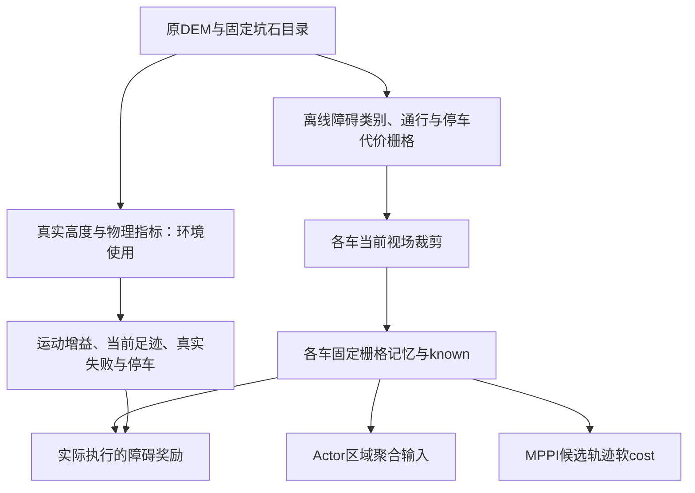

# 局部障碍输入、地形记忆及避障代价改造规划

日期：2026-10-22。状态：**首版已实施验收，并按用户指令切换新策略正式训练**。本文保留12,231点来源及配置审计，并按实际实现更新；[实施记录](../experiments/t11_local_obstacle_input_2026-10-22.md)提供代码、配置、来源、失败日志及性能证据。实施验收阶段已提交527诊断底层步，加失败未提交上界100，计费上界627／800，0优化更新；其后用户已授权停止旧训练并启动新run，见[正式切换](../experiments/t11_obstacle_input_training_2026-10-22.md)。

## 1. 目标行为与本批边界

将生成时已知的坑、岩石转成进入局部视场即可获得的障碍信息，使策略有可辨识的避障输入，MPPI在候选轨迹上付出障碍cost，策略在实际执行后收到对应奖励反馈。继续使用真实DEM＋现有坑石几何作为环境地形。感知、记忆、代价在现有职责内改造，不外加避障行为控制器。

本批推荐保留`hazard_response_version=cost_reward_only_v1`：新增障碍项是软cost／奖励，不据障碍标签强制刹停、投影动作、过滤高层目标或重新开启预测完整足迹拦截。车辆动力学、轮速／加速度限幅、邻车与世界边界以及现有未知边界约束继续执行。当前MPPI仍有中心地形／未知／邻车等prescreen；“关闭完整预测足迹”不等于全部硬约束关闭。

最小验收：同一障碍几何和已观测范围能贯穿地图、Actor、MPPI和执行奖励；近障／侵入代价方向正确，未知不冒充空地，实际失败与停车仍有真实地形依据；小规模采样计数、TensorBoard和性能可核对。低成功率形成结果，不自动追加训练或扩展方案。

## 2. 每车12,231点究竟是什么

当前设计profile的局部视场为车体坐标`x∈[-15,15] m`、`y∈[-8,8] m`，两个方向间距均0.2 m，网格包含两端：

```text
纵向节点：30 / 0.2 + 1 = 151
横向节点：16 / 0.2 + 1 = 81
每帧节点：151 × 81 = 12,231
```

这是**二维位置网格上附带地形属性的理想局部观测**。每个位置查询高度、两个坡度分量、粗糙度和通行评分；没有在高度方向再划分12,231个体素，也不是实际激光雷达发射的射线数。

实现链路：

1. `PerceptionSpec.frame_shape/sample_count`按视场和spacing计算尺寸。
2. `DenseSensor.sample`将完整网格随各车当前位置和朝向变换到世界坐标，批量向SceneBank查询地形；不是12,231次Python函数调用。
3. 对每个节点使用原网格3×3邻域的高度计算去平面粗糙度。这些邻域复用同批高度，不能再把后端查询点数乘9。mmap查询内部的四角双线性读取则是每个查询点的内部工作。
4. 生成完整`SensorFrame`，交给每车私有记忆，再由Actor、MPPI、实际足迹和中心特征等消费者读取。

`UpstreamEnvironment.tick`每个0.2 s底层控制步调用`_refresh_and_predict`，所以是**每模拟秒5帧／车**，不是每墙钟秒5帧。当前实现还先对owner内全部环境采样，再只给active环境更新记忆，已结束环境也可能支付扫描开销。reset另有初始感知；接受出生后的完整刷新也仍然存在。

| 口径 | 完整视场查询位置数 |
| --- | ---: |
| 每车每帧 | 12,231 |
| 每个四车团队每帧 | 48,924 |
| 16环境／64车合计一轮底层tick | 782,784 |
| 16环境完整5 s策略区间，最多25轮tick | 19,569,600，另加reset |

最后两行描述所有车都参与对应tick的总量，不是有效物理步数；提前结束、异步reset及当前全环境扫描需分别记账。一个团队tick只计一个底层环境步，不能按四车重复计费。

Actor主地形输入是112位置×2通道，另有25个目标区域位置×3值及中心／邻车等输入；112不是前端只扫描112点。上一轮出生优化713点／车仅用于候选出生检查，不改变在线完整感知。

代码定位：`upstream_spec.py::PerceptionSpec`、`upstream_sensing.py::DenseSensor.sample/_sample_features`、`upstream_environment.py::_refresh_and_predict/tick`、`upstream_observation.py::_terrain/actor`。

## 3. 当前有效基线与配置来源

运行入口为`configs/experiment/upstream_1km_soft_hazard_v1.yaml`＋`configs/training/upstream_1km_far_soft_hazard_v1.yaml`。实验YAML含本身共20层继承；只读顶层文件不能获得有效配置。设计profile为`configs/design/upstream_vehicle_proxy_1km_v1.yaml`。正式并行度由CLI覆盖为16环境／4 owner／每owner双线程，实验YAML的`num_envs=2`不是实际并行度。

| 配置／数据来源 | 当前有效值 | 本批处理 |
| --- | --- | --- |
| 实验运行模式 | A1，seed23，CPU策略，CUDA MPPI512×2 | 保留计算预算作初次比较基线 |
| 控制／规划／策略周期 | 0.2／1／5 s；规划40步、8 s；模拟延迟0.5 s | 保留，先不把降频收益混进输入改造 |
| 地图 | 4张1 km地图：train_0、train_1、fixed_eval、unseen；SceneBank mmap | 引用同一组原图，新增派生标签manifest |
| 原始／处理间距 | DEM 5 m；地图处理0.1 m，10000×10000；地形指标基线0.8 m | 保留来源和高度，不把处理精度当实测精度 |
| 坑生成 | 直径0.8–2.0 m；深／直径0.08，缘高／直径0.025 | 保留几何、目录、seed与分布 |
| 岩石生成 | 直径0.6–1.2 m；高／直径0.3 | 保留 |
| 实际enhancement | `nasa_sfd_v2`；fractal=false；buffer=5 m；probability spacing=0.1 m；max_features=50000 | 以各scene manifest的有效值为准 |
| 四图seed | 23、24、104729、130363 | 保留各图身份和地理划分 |
| 行驶／停车／粗糙度／台阶 | 10°／5°／0.05 m／0.1 m | 保留真实失败／停车阈值 |
| 通行评分参数 | slope scale=0.6，RMS scale=0.05 m，目前在`make_collector`内构造 | 新输入配置显式记录，不静默更改 |
| 传感器 | 前后15 m、侧向±8 m、0.2 m节点；支持半径0.155 m | 视场保留，点帧改固定栅格；支持半径不再决定新栅格查询 |
| 点记忆 | key resolution=0.1 m、capacity=65536；精确坐标保留、native合并、KD-tree | 新栅格路径替换，不伪装成旧点记忆 |
| MPPI缩放 | goal=2、terrain=3、neighbor=0.5、smooth=0.5；noise_v=0.375、noise_w=0.15、temperature=0.5 | 保留；障碍项独立权重与计时 |
| 实际地形奖励 | terrain_weight=0.5、hazard_cost=0.05、failure_penalty=100 | 首版保留物理地形项，独立加入障碍项并分别记录 |
| 采样／学习 | 32策略决策／批、5 PPO epochs、初始连续std×0.25、初始HOLD概率0.35、running价值归一化 | 本批不调PPO或探索参数 |
| 出生／任务 | R200–300 m、无课程、1500 s、maximum_spawn_attempts=4096 | 保留物理合法出生，不按新软cost额外筛掉近障初态 |

地图事实取自`outputs/runs/lunar_terrain_validation/npb_1km_fixed_20261021_01/scenes/<role>/scene.json`。每图现有`feature_catalog`含37,499个坑、890块岩石；生成缓冲与实际影响目标区的对象范围须结合目录字段判断。`configs/terrain/nasa_sfd_v2.yaml`默认`max_features=10000`，不能拿它直接重建并宣称原地图未变。

## 4. 推荐的数据流



离线全图只由环境／传感器所有者持有。策略、规划及新增避障奖励使用当前可见或过去已观测的局部信息；全图最短路、未见障碍和由未见障碍决定的全图距离场不进入这些输入。独立实际失败判定继续有物理依据。

### 4.1 地形、标签与障碍几何

推荐首版将标签作为**避让代价来源**，不把标签内所有位置定义成新的失败终端：

- 岩石：按目录的实际水平投影圆盘标注，半径D/2，保留类别位；栅格采用几何相交的保守标注。
- 坑：坑口圆盘`r≤D/2`作为避让区域；坑缘外的真实超限部分由地形风险层补足。当前坑剖面的高度影响可延伸到`r<D`，不直接把全部非零尾部都标成实体障碍。所有坑禁行与只避让危险坡面是不同任务；本版采用坑口软避让，实际可跨越性仍由真实足迹决定。
- 基础DEM：保存独立的坡度、粗糙度／台阶风险，不能把“无坑石标签”解释为“地面一定安全”。
- 不通过`layer_craters>0`判断坑；坑底高度变化可为负，叠加／零交叉也不等于无障碍。优先使用目录几何和派生风险层。
- 重叠障碍取类别位并集，基础风险取明确的max／归一化组合，不因多个目录对象覆盖同一格而重复累加处罚。
- 新标签引用原高度、目录、生成参数及SHA；不重新随机生成坑石、不覆盖原scene。已有地图追加派生标签，新地图构建时再一次性同时生成。

实际采用障碍标签0.2 m、普通地形0.8 m两种分辨率；标签直接由目录圆盘与0.2 m格的几何相交计算，不用低密度点命中。普通地形从0.1 m原生features按0.8 m块保守聚合，不能用均值把危险坡度／RMS抹掉。真实高度保留原0.1 m处理网格，无效地形保留unknown。

派生层包括`obstacle_kind`、`drive_cost`、`park_cost`和`valid`；另保留内部`ground_motion=[slope_x,slope_y,traversability]`供MPPI预测地形速度增益及已有中心地形prescreen使用，这三值不进入Actor主地形通道。不能只存一个风险标量后假装仍能计算有方向的地形运动增益。

建议地面风险定义为坡度比、RMS比、局部台阶残差比及`(1-traversability)/0.75`各自平方的和，截到[0,100]供MPPI读取；Actor通道再截到[0,1]。drive／park分别使用10°／5°坡度阈值，其余物理阈值同源。局部台阶残差在0.8 m来源块内，以原生高度去除块平均坡面后取最大绝对残差；块内任一原生valid缺测则不声称代价已知。高度均值、最坏坡度向量、最大RMS及最小通行评分离线保存。它描述局部不连续，不继续把候选轨迹相邻时刻的正常爬坡高差直接等同实体台阶。离线RMS和新栅格风险不再声称等价于随车旋转3×3采样的旧数值，进入新cost／感知身份；实际失败仍用原物理足迹。

### 4.2 感知、固定记忆与索引

| 项目 | 推荐首版 | 语义／实现要求 |
| --- | --- | --- |
| 感知模型 | 理想局部语义栅格 | 保留前后15 m、左右8 m；不引入识别网络 |
| 更新周期 | 0.2 s | 本批不降频；静止同视场仅更新时间／复用内容 |
| 地图坐标 | 固定世界栅格ID，观测按episode里程计变换 | 格子不会因车移动而生成新点；Actor仍用本车坐标 |
| 揭示规则 | 完整0.2 m格及其0.8 m来源格均在当前视场内，且原数据valid | 粗格风险不能携带视场外证据；边缘暂留unknown，不因目录对象局部可见就泄露整物体未见边界 |
| 栅格／块大小 | 0.2 m；32×32 cells／块 | 按块分配，避免给每车复制整张1 km图 |
| 记忆预算 | 65536 allocated cells，最多64块 | 新含义为格子容量；确定性淘汰视场外最久未见块，同时间按固定块ID打破并列，保留当前可见块 |
| 静态重观测 | 同格复用属性，刷新时间 | 后端属性读取集中于新揭示／未驻留区域；不是重复合并浮点坐标 |
| 空间查询 | 坐标计算行列号＋块索引 | 普通查询不构建KD-tree；CPU／CUDA复用同一几何身份 |
| CUDA同步 | 只上传变化块、known和必要视图 | 不每个规划调用重打包所有历史点 |
| 只读快照 | 带地图、episode和内容revision的局部视图 | 旧规划／异步消费者不能看到随后原地修改的数据；checkpoint完整保存局部记忆 |

仍可能每帧处理约12,000个布尔可见格或块内掩码；性能目标是消除同区域的多属性重采样、3×3重算、浮点点集合并和空间树重建，不能宣称改成栅格后所有操作只剩112次。

距离／软带必须从**已观测障碍格**计算；变化块更新其影响范围，保留unknown边界。若缓存距离场，要以局部记忆revision失效，并处理软带halo，不能读取全图距离后仅遮掉最终输出的未知格。

### 4.3 Actor、Critic、目标区域与通信

推荐首版主地形输入为112位置×3通道：`obstacle_proximity`、`ground_cost`、`known`。第一通道表达障碍软带风险，第二通道表达基础地面风险，第三通道为区域已知面积比例，显式区分未知与部分覆盖。各值归一化到[0,1]；完全未知时前两值置0，由known=0单独表达；旁路的`terrain_known`布尔数组仍表示区域完整已知。内部保留`park_cost`供停车目标评价与实际反馈，普通地形cost不是完整停车证书。

| 消费者 | 当前 | 计划变化 |
| --- | --- | --- |
| Actor主地形块 | 112×2，高度＋综合风险 | 112×3，障碍接近风险＋地面代价＋known；不再输入相对高度 |
| 112位置的读取方式 | 查最近的直接观测点 | 每个位置代表的覆盖小区域取最大风险／最小间距、并记录known；避免漏掉两采样点之间的0.6 m岩石 |
| 112布局 | 7×9近区、3×7中区、4×7远区 | 首版保留布局，定义各小区域的物理边界和边缘聚合；不把远区位置当无面积的点 |
| 25目标区域，75值 | 高度、风险、known | 障碍风险、地面／停车综合风险、known；维度仍为25×3 |
| ego／邻车／意图／任务时钟 | 15＋3×17＋5汇总＋115附加＋1时钟 | 除地形含义和必要索引偏移外保留 |
| Actor总维度 | 411 | **523**，增加112；encoder的3个地形分支输入通道同步改3 |
| Critic局部网格 | 四车各112×2，另5个地形汇总 | 四车各112×3；汇总为已知部分障碍风险mean／max、地面风险mean／max、known面积比例，全部未知时风险汇总为0 |
| Critic总维度 | 991 | **1439**，增加4×112；9个Oracle保留槽仍为0 |
| FULL邻车消息 | 可含sender当前5维物理地形特征 | 首版保留物理特征定义，不假装它们是障碍通道；不广播新全图／障碍目录 |

维度变化需同步encoder、policy构造、Actor／Critic常量、rollout／owner协议中的断言与归档shape。网络参数量可能小幅增加；前端提速来自数据处理变化，不能把“降低三维输入”误写成必然降低网络向量维度。若以后决定再加入独立parkability通道，需要重新计算维度，不能暗改523的含义。

区域边界按各分支原采样轴相邻位置的中点划分，外边缘裁剪到该分支的原物理覆盖范围；三分支独立允许重叠。区域与固定栅格的交叠按面积计算known，风险对已观测交叠格取最大值。区域聚合不向局部风险重复加车体膨胀；Actor看到障碍本身及软带，规划再结合车体计算间距。不能把“区域有一个已知点”当作全区域已知。

## 5. 规划cost与执行奖励

### 5.1 统一的几何量

`d_i(t)`实际采用**有向车身矩形（含现有0.3 m裕量）的54圆盘覆盖近似**到已观测障碍格的有符号间距。圆盘网格间距不超过0.8 m，实际覆盖半径约0.5173 m；距离再扣0.2 m格的半对角线0.1414 m。外部距离保守，负值为软侵入深度近似，不能当作精确矩形接触／碰撞证书。车辆尺寸仍5.015×3.2 m，保留航向，不只算车心距；真实接触足迹认证仍走原物理判据。

实现时按局部块和软带范围剔除无关格，CPU／CUDA批量计算矩形与占据格间距／交叠；不形成“所有预测姿态×整图／完整历史点”的矩阵。若以栅格距离场近似矩形间距，必须显式记录近似方式并用车头、车侧、转向案例验收，不能静默改成外接圆硬膨胀。具体kernel在实现阶段用静态面板验证，未测得速度前不承诺倍率。

定义初始软带宽`b=1.0 m`，近障风险`q(d)=clip(1-d/b,0,1)^2`，交叠量`p(d)=clip(-d/b,0,1)`。这两个项只在附近或侵入时惩罚，没有“距离无限变远就持续得正奖励”的项。没有已观测障碍或最近已知障碍超出软带时两项为0，日志距离可截到±b；unknown覆盖另记，不把“没看到障碍”当成“整车周围已知无障碍”。

### 5.2 MPPI

```text
J_obstacle = Σ预测控制段 Δt × [w_near × q(d) + w_overlap × p(d)]
```

推荐待测初值：`w_near=3.0 cost/s`，`w_overlap=20.0 cost/s`，使用0.2 s预测间隔／8 s时域；正交于既有`terrain_scale=3`，不再二次乘terrain_scale。进入候选评价、均值轨迹及最终候选重评分的同一cost函数，不只对512条随机轨迹加项。

原goal、neighbor、control、smooth、reverse、unknown继续单独记账；原terrain项改读局部固定格的地面风险，原预测高度差项由新的局部台阶风险替换。unknown仍按原约束处理，不因障碍项有限而允许穿过未观测区域。新增障碍cost默认不改变safe布尔值，也不新增HOLD／停车储备准入；现有其他prescreen单独保留并在记录中区分拒绝原因。

规划轨迹跨越已知／未知边界时，只能使用各查询位置已有的局部信息。车身或软带超出已知范围的部分不能由全图补全；保留相应known状态。

### 5.3 PPO收到的执行奖励

```text
r_obstacle(t) = -Δt × mean_四车 [v_near × q(d_actual) + v_overlap × p(d_actual)]
```

推荐待测初值：`v_near=0.2 reward/s`，`v_overlap=2.0 reward/s`。沿实际执行轨迹每0.2 s结算，在本步执行后的实际姿态评价车身间距，使用本步运动前已经合法获得的局部障碍快照；不用计划轨迹、请求终点或候选均值，避免事后揭示改变同一动作的评价依据。新发现物体在后续步生效；真实失败始终照常判定。

维持四车均值聚合与现有团队奖励口径，不乘预测时域或MPPI样本数，不直接把`J_obstacle`塞进PPO奖励。宏步按既有`Σ g^k r_k`和真实duration折扣；新增项以每秒权重乘Δt，避免未来改控制周期时无意改变强度。

保留gather、flatness、驻留、energy、现有实际terrain／hazard项和终端惩罚；新项单独叫`obstacle_near`与`obstacle_overlap`。本批不叠加新绕行路径奖励、规划器成功奖励或额外远离势函数。旧hazard项衡量真实坡度／粗糙度／速度损失，新项衡量可见障碍接近／侵入，记录两者占比以检查重复主导。

`failure_penalty=100`仍只在现有真实collision、out_of_bounds、terrain_failure等终端触发；语义格交叠不新增失败终端。`collision_cost=100`是现有实际碰撞项，不能误当成新障碍近距权重。

所有新权重是有单位的**首轮待测初值**，不是已验证最优配置。最小数值面板需覆盖`d/b=-1,-0.5,0,0.5,1,2`及直行／绕行／原地HOLD，对比gather和地形项规模；静态面板足以发现符号或量纲错误后即推进，不先做大范围调参。

## 6. 配置文件、字段与版本变更清单

以下为已经落地的配置。`upstream_obstacle_spec.py`统一解析，sensor／memory／encoder／MPPI／reward／评估共享同一份身份；物理阈值从原vehicle spec派生，不在新YAML重复手写。原地图manifest仍作为地形来源，新atlas用原scene SHA定位。

| 文件／归属 | 有效字段或调整 | 实现／迁移 |
| --- | --- | --- |
| `configs/terrain/upstream_1km_obstacle_input_v1.yaml` | `version=local_obstacle_input_v1`、`atlas_root=outputs/runs/local_obstacle_input/atlas_20261022_01` | 单一新输入定义，不复制PPO或NASA生成分布 |
| `labels` | `resolution_m=0.2`、`crater_region=mouth_disk`、`rock_region=projected_disk`、`rasterization=any_intersection` | 原scene、目录及派生数组SHA关联 |
| `ground` | `resolution_m=0.8`、`aggregation=conservative_native_max_v1`、`slope_score_scale=0.6`、`rms_score_scale_m=0.05` | 原生0.1 m块聚合；drive／park阈值继承10°／5°、RMS0.05 m、step0.1 m |
| `perception` | `forward_m=15`、`reverse_m=15`、`lateral_m=8`、`update_period_s=0.2`、`reveal_rule=full_cell_in_fov` | 同时检查细格及粗格来源支持；固定格宽不再代表随车151×81节点 |
| `memory` | `tile_cells=32`、`capacity_cells=65536`、`eviction=oldest_unseen_tile` | 私有64块；known／scanned／类别／地形／局部距离；确定性淘汰，不持全图引用 |
| `observation` | `version=obstacle_ground_known_actor_v1`、`aggregation=region_conservative` | 由版本派生112×3、Actor523／Critic1439，25目标区域仍3通道 |
| `geometry` | `distance=oriented_rectangle_cover_disks_v1`、`cover_spacing_m=0.8` | 54圆盘覆盖近似；车身／裕量从原spec派生，仅用于软cost |
| `cost` | `soft_band_m=1`、`near_weight_per_s=3`、`overlap_weight_per_s=20`、`hard_obstacle_rejection=false` | runtime cost身份`upstream_grid_obstacle_soft_cost_v1`；样本／均值／最终重评分同源 |
| `reward` | `near_weight_per_s=0.2`、`overlap_weight_per_s=2`、`team_reduce=mean`、`observation_time=pre_step` | 实际执行后姿态、运动前快照、Δt及四车均值；原项保留 |
| `configs/experiment/upstream_1km_obstacle_input_v1.yaml` | 继承soft-hazard；`obstacle_input_config`及新`observation_execution_version` | parser与metadata已接入；保留`cost_reward_only_v1`及`projection_disabled` |
| `configs/training/upstream_1km_far_obstacle_input_v1.yaml` | 固定far／1500 s／无课程，原scene_manifests及PPO设置 | 新run需全新策略／Critic／Adam／归一化状态，不直接恢复旧checkpoint |
| 地图入口 | `build_local_obstacle_atlas.py --scene`；新图`build_lunar_training_maps.py --obstacle-experiment-config` | 已有四图只做派生；不修改原scene或重抽坑石 |
| 恢复／日志 | 输入spec／atlas SHA、观测／cost／物理来源身份、tile状态、当前计数及奖励拆项 | 新旧语义隔离；CUDA缓存恢复后重建；保持源码guard与TensorBoard |

新物理设计profile不是本批必需：车辆尺寸、真实地形阈值和控制时序未变，先在runtime输入spec中显式选择新感知后端。旧`PerceptionSpec`的dense字段只服务旧路径和必要的真实局部足迹测量，新路径不能伪造其sample_count／support_radius契约。若实现确需拆分数据结构，在同一spec职责内重构，保持旧profile读取及fingerprint不变。

保留的训练配置还包括：`policy_decision_period_s=5`、`discount_reference_period_s=1`、`gamma=0.9975992791345717`、`lambda=0.99`、reward／observation log1p、32决策／5轮PPO、checkpoint每5批、原评估日程与上限。0.2 s底层折扣仍由时间配置同源派生。新实验预算及启动单独安排，不从“形成规划”推导新增200万步授权，也不擅自中止原run。

## 7. 已实现代码与物理判定保留

| 职责／文件 | 已落地变化 |
| --- | --- |
| `terrain_data/obstacle_atlas.py`、`build_local_obstacle_atlas.py`、`build_lunar_training_maps.py` | 从原scene／目录派生标签与粗地面风险；原生成几何及文件保持 |
| `upstream_obstacle_spec.py`、`upstream_spec.py` | 单一输入spec、parser允许字段、派生维度与元数据；旧profile读取保持 |
| `upstream_grid.py` | 视场揭示、私有固定格、不可变tile、内容revision、距离halo、CPU/CUDA直查及增量上传 |
| `upstream_sensing.py` | 完整dense路径保留；713点即时物理测量支持选取环境对应scene并计数 |
| `upstream_environment.py` | active环境语义更新、当前完整物理足迹报告／运动特征、pre-step奖励快照及恢复身份 |
| `upstream_observation.py`、`upstream_ablation_learning.py`、`upstream_skrl.py` | 新三通道区域聚合、Actor／Critic维度和汇总；原网络编码器复用 |
| `upstream_planning.py`、`upstream_mppi*.py`、`upstream_factory.py` | grid查询、粗地形运动／cost、障碍软cost全候选接线、CUDA旧平地核隔离及planner缓存身份 |
| `upstream_reward.py` | 实际near／overlap执行项、Δt和四车聚合、独立元数据 |
| `upstream_queue.py`、`upstream_rollout.py`、`upstream_process_rollout.py`、`run_upstream_t11.py` | 私有快照排队／恢复、动态维度、owner状态／计数与统一配置传递 |
| `upstream_curriculum_experiment.py`及探针 | JSON／TensorBoard新增奖励、cost、间距和读取统计；保持实际步轴；0更新有界性能验证 |

环境端保留高度、梯度与实际接触测量，用于`terrain_gain_numpy`、当前行驶／停车足迹、真实终端和原奖励。已将这些测量限制到当前车体及完整粗糙度邻域，共713个原随车网格查询位置／车，静止可复用；不维护整个30×16 m真实高度点历史。即时来源区别于旧历史危险点合并，显式记录`physical_measurement=instantaneous_original_grid_footprint_subset_v1`；几何、支持点与阈值保持，但不宣称所有物理报告逐值等价。

已知物理超限仍为有效学习的`terrain_failure`，缺测／退化几何仍是无效环境；新unknown格不自动变成物理失败。真正的行驶／停车状态继续使用真实完整足迹，不能用一个栅格风险值替代证书。

## 8. 实施顺序、验证范围与结束条件

| 顺序 | 要回答的问题 | 最小交付／验收 |
| --- | --- | --- |
| 1. 固定定义与派生标签 | 标签是否正确覆盖实际坑石，且没有意外改变原图？ | 同一目录的坑底、坑缘、岩石边缘、重叠及无效区检查；原高度／目录SHA一致；报告占据比例、车身近障比例及可通行区域分布 |
| 2. 接入局部固定记忆 | 能否只揭示视场内格，并免除点合并和KD-tree？ | 平移、旋转、反复观察、跨块、unknown和异步reset／恢复；同输入CPU／CUDA局部读取一致，记录新增格及上传量 |
| 3. 接通观测、cost、奖励 | 真实靠近／侵入是否贯穿三处且量纲正确？ | 小障碍落在112位置之间仍可见；车头／车侧／转向间距；均值／样本／重评分全部含cost；实际奖励pre-step信息、Δt和四车均值正确；新旧恢复隔离 |
| 4. 有界采样复测 | 前端节省能否转化成整体吞吐？ | 建议4 owner×4环境、2个5 s区间，最多800实际底层步、0 PPO更新；初始化和运行分列，固定出生／动作对照，记录差异与新行为 |
| 5. 小学习验证 | 网络是否利用障碍输入与执行反馈改善避障？ | 在上一项完成后安排单独、有明确预算的学习；比较障碍接近／交叠、真实terrain_failure、靠拢与完整任务成功，不以停住不动当避障成功 |

第1—4项已完成，213项不同检查通过；第4项因原16环境长训并发，实际采用1 owner×4环境、2区间配对，计费上界627／800步、0 PPO更新。前端固定帧2.09倍，整体采样4.377→5.623步/s（+28.45%），初始姿态和高层动作一致；新输入／cost使轨迹与实际终止步数有差异。失败CUDA尝试与首版聚合性能回退均保留并修复，最终events可回放。第5项已按后续用户指令启动新策略正式训练，使用旧run停止后的剩余预算；学习避障效果仍待实际结果。

阶段验收达到即推进。只有具体的输入泄露、标签错误、符号／尺度错误、计费／恢复缺陷或无法运行阻塞下一项；低成功率和吞吐不足是结果，不反复增加无关回归。首轮不自动改变地图密度、出生分布、动作保持时间、MPPI预算或PPO参数来掩盖问题。

### 最小记录字段

- 配置／来源：原scene SHA、派生标签SHA、有效输入spec、观测／cost／reward版本、CPU线程／owner数／设备、恢复边界。
- 性能：语义揭示、后端读取、记忆更新、局部距离／几何、CUDA同步、物理足迹、观测编码、MPPI各自耗时；初始化单列；实际底层steps/s。
- 数据规模：每帧可见格、新揭示格、驻留块／淘汰块、上传bytes；旧路径点查询与新路径格操作分别计数。
- 行为：每车最小可见障碍间距、近障时间、交叠深度／持续时间、unknown覆盖、gather／HOLD／行驶距离；实际失败原因及停车／完整集合成功率。
- 反馈：MPPI obstacle／terrain／goal／unknown项的分布，PPO obstacle_near／obstacle_overlap／terrain／gather／terminal的逐项return；静止与绕行样例。

## 9. 实施结论与下一步

首版已覆盖生成标签、感知、私有固定格、Actor／Critic和目标区域、MPPI rollout／评分、实际奖励、真实失败／停车、出生、owner／恢复、评估入口和日志。落地时以0.8 m普通地形降低动态采样工作，保留0.2 m小障碍标签；有向矩形使用54圆盘覆盖的明确近似，只用于软cost／奖励。原车辆模型、控制时序、物理阈值和旧配置保留。

本次达到实现／有界吞吐出口，证据见[实施记录](../experiments/t11_local_obstacle_input_2026-10-22.md)。实施验收阶段未切换旧run；后续已按用户指令停止旧训练，并在原总预算的剩余1,497,631步内启动全新策略／Adam，见[训练记录](../experiments/t11_obstacle_input_training_2026-10-22.md)。权重和距离近似仍待学习检验，不把cost贯通当作避障效果结论；旧checkpoint不可直接转换。
